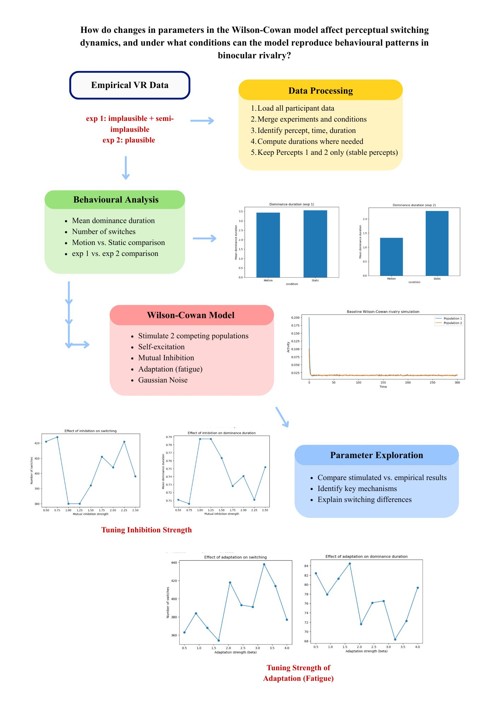
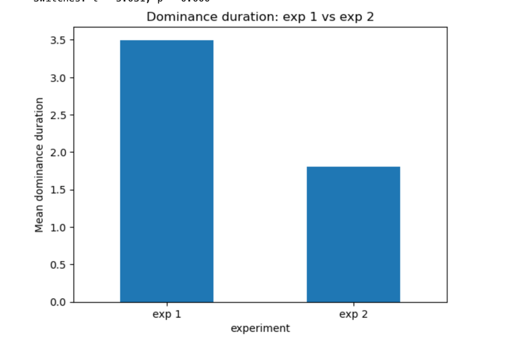
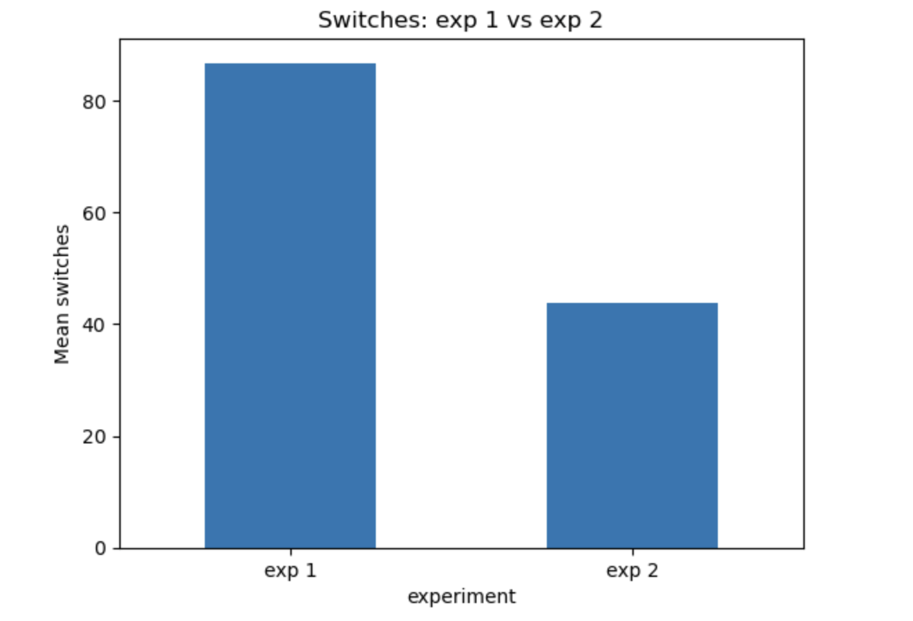
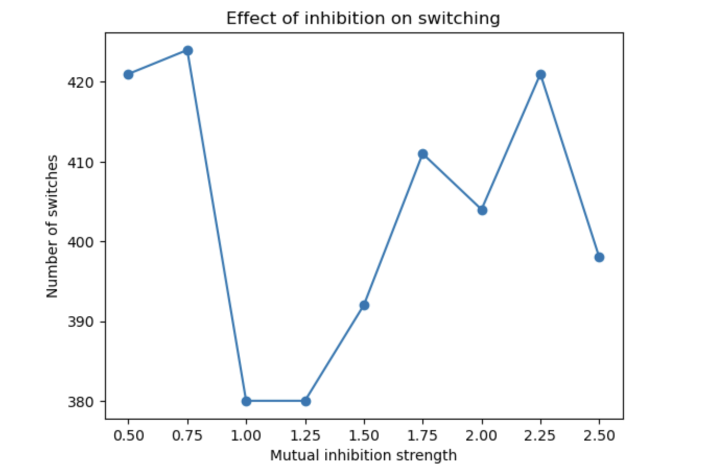
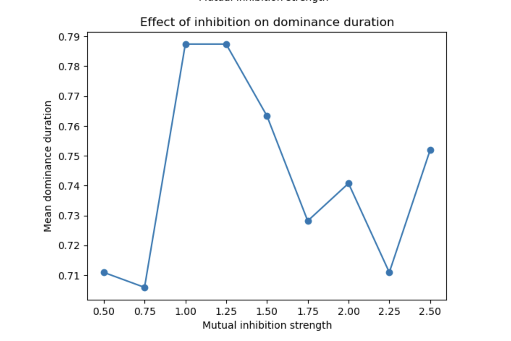
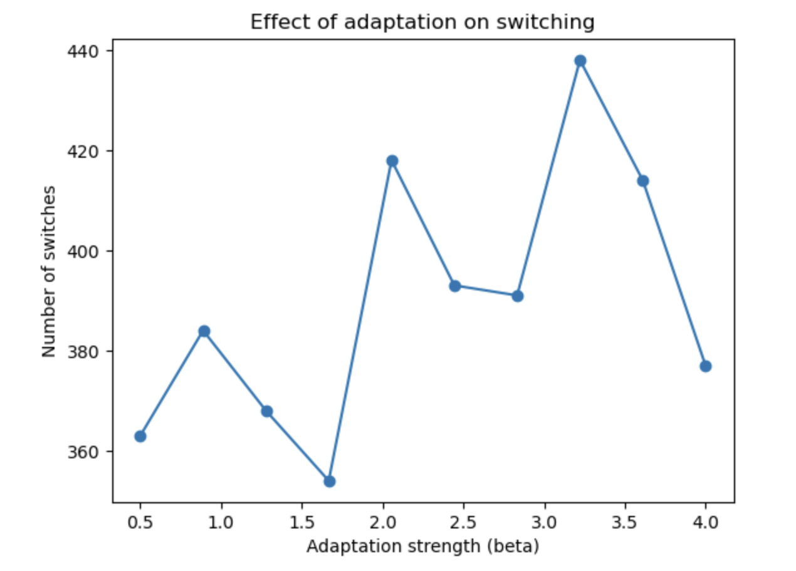
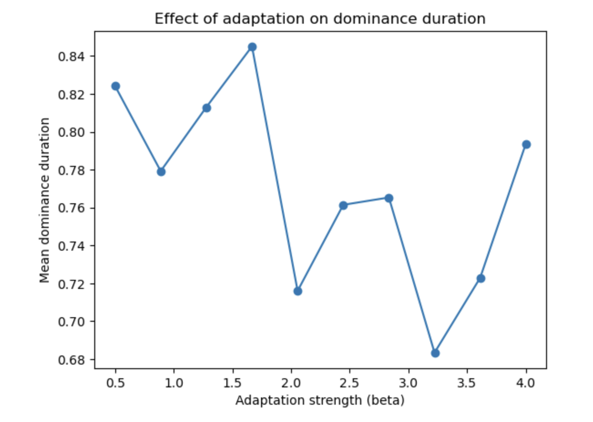

# Computational modelling of binocular rivalry

> Original 2026 coursework report, transcribed to Markdown. Assessment coversheet and personal metadata omitted. Original scientific wording is preserved; see the repository README for verification notes.

## Introduction

Binocular rivalry occurs when different images are presented to each eye, leading to alternating perceptions (Seely and Chow, 2011; Han et al, 2024). These spontaneous switches provide a window onto competitive neural dynamics and the roles of mutual inhibition, adaptation, and noise in vision (Seely and Chow, 2011). Previous research tended to apply artificial 2-dimensional stimuli, it was thus unclear whether the same mechanisms control rivalry under more naturalistic visual environment (Han et al, 2024). Han et al (2024) addressed this gap by presenting stimuli via virtual reality (VR) with geometrically implausible, semi-plausible, and plausible layouts that implement partial occlusion in real world, where their findings revealed robust rivalry across layouts.

Mechanically, binocular rivalry and other perceptual bistability can be modeled with Wilson-Cowan style population rate equation, where neural population encoding with alternative percepts compete through mutual inhibition, experience slow negative feedback, and are driven by stochastic input (Huguet et al, 2014). Huguet et al (2014) revealed that in a multi-stable motion paradigm where noise hugely governs switching time whereas adaptation biases the selection of percept, highlighting their distinct contributions. Seely and Chow (2011) and Wilson (2003) demonstrate that architecture of mutual inhibition with adaptation, with appropriate parameters, can capture binocular phenomenon such as Levelt’s-like contrast dependencies.

In our project, we thus combined empirical data from Han et al (2024) with a simplified Wilson-Cowan two population model to investigate on how do changes in parameters in the Wilson-Cowan model affect perceptual switching dynamics, and under what conditions can the model reproduce behavioral patterns in binocular rivalry. It was hypothesized that adaptation strength will have a greater impact on switching dynamics than inhibition strength.

## Method

Approach

We combined empirical data with computational modelling via Python language to investigate dynamics in binocular rivalry. Behavioral data was obtained from Han et al (2024), a VR study where participants were presented with geometrically implausible, semi-plausible, and plausible layout stimuli; and tracked rivalry alternations for all three layouts in both static and moving stimuli (Han et al., 2024). In Experiment 1, effects of implausible and semi-plausible layouts on BR dynamics were being compared; whereas Experiment 2 adapted geometrically plausible condition where a closer object partially blocks the view of a more distant object from the perspective of using just one eye (Han et al., 2024). Note that in both experiments, participants underwent both Motion and Static stimuli for each layout.

Raw data files of all participants were first loaded and combined into a single dataset for further analysis. Key variables including duration, time, and percept identity were specifically identified. For datasets without direct provision of dominance duration, durations were thus computed from time differences between successive percept reports. Only stable percepts (coded as 1 and 2 in the coding script) were kept, while mixed or invalid percepts were removed from the dataset to ensure consistency when measuring rivalry dynamics.

We then extracted behavioral measures at the participant level. Mean dominance duration was reflected as the average time each percept remained dominant, and the number of perceptual switches was approximated as the number of transitions between percepts. These were compared across conditions. We also conducted independent sample t-test to test the differences between Motion and Static condition within each layout, and between Experiment 1 and Experiment 2.

A simplified Wilson-Cowan model was implemented to better understand the underlying neural mechanism. It simulated rivalry between two neural populations representing alternative percepts. Each population performed self-excitation and mutual inhibition. The model also included fatigue as its adaptation term as well as Gaussian noise to simulate real-world noises. The output of the model was converted into percept sequences, which extracted switching rates and dominance duration with the same approach as for empirical data.

Finally, we conducted parameter sweepings to investigate how changes in model parameters can influence rivalry dynamics. Both mutual inhibition strength and adaptation strength (ß) were varied systematically, we then evaluated their influences on dominance duration and switching behavior.

Method Diagram

Schematic overview of the analysis pipeline is shown on the figure below. Our workflow includes I) data processing, II), behavioral analysis, III) Wilson-Cowan modelling, and IV), parameter exploration.

## Results

Behavioral Results

Independent sample t-tests on empirical data suggested no significant differences between Motion and Static conditions within both Experiment 1 and 2. For Experiment 1, no significant effect of condition on mean dominance duration, t = -0.289, p = .775, or number of switches, t = 0.167, p = .868, were found. Similarly, for Experiment 2, no significant effect on dominance duration, t = -0.432, p = .672, or number of switches, t = -0.095, p = .926, were found.

However, comparison across experiments revealed a different pattern. Figure. 1 shows that mean dominance duration between Experiment 1 and Experiment 2 did not differ significantly, t = 1.997, p = .052, although approaching significance threshold of .005. However, Figure. 2 reveals a significant difference in number of perceptual switches, t = 5.031, p < .001, suggesting a difference in switching dynamics between laboratory and naturalistic viewing environments.

These results suggest while binocular rivalry is observed across different geometric layouts, the rate of perceptual switching is sensitive to the visual environment.

Figure 1. Mean dominance duration across experiments  Figure 2. Number of switches across experiments

Model Results

Baseline simulation of the Wilson-Cowan model incorporating adaptation and noises produced clear switching activity between the two populations, which is consistent with rivalry-like activity. The model succeeded in generating perceptual switching, with short dominance duration and high switching frequency.

Parameter exploration discovered that altering mutual inhibition strength of the model had only minimal impact on switching behavior (Figures 3 and 4). Both the number of switches and dominance duration remained relatively stable despite trying a range of values, suggesting that inhibition alone did not effectively influence rivalry dynamics.

Figure. 3, Effects of varying inhibition strength on switching rate

Figure. 4, Effects of varying inhibition strength on dominance duration

On the other hand, altering adaptation strength (ß) (Figures 5 and 6) revealed systematic influences. Increasing ß led to shorter dominance duration and higher switching frequencies. This indicates that stronger adaptation can cause the dominant population to fatigue more speedily, which allows the competing population to take over more frequently.

Figure. 5, Effects of varying adaptation strength on switching rate

Figure. 6, Effects of varying adaptation strength on switching rate

## Discussion

This present analysis suggests that binocular rivalry persists both laboratory and naturalistic layouts in VR, but switching dynamics differ between Han et al (2024)’s Experiment 1 and Experiment 2: with one using implausible and semi-plausible layouts, and the latter using plausible layouts. Behaviorally, similar mean dominance durations were observed across experiments, but a significantly higher switching frequency in the artificial layouts compared with the geometrically plausible, naturalistic layouts indicating that the rate of perceptual alternation may be modulated by the realism of the visual environment. This aligns with Han et al (2024) that binocular rivalry is a consistent phenomenon under naturalistic geometry, while also showing that its sensitive to the scene structure.

The Wilson-Cowan simulation further complements these findings by revealing that within the chosen architecture, varying the mutual inhibition strength had only minimal impact on rivalry dynamics, whereas systematic increases in switching rates and decreases in dominance duration are produced when increasing adaptation strength. This pattern is consistent with the competition model where realistic dominance statistics increases when the system operates near the boundary between noise-driven attractor regime and adaptation driven oscillatory (Shpiro et al, 2009). Huguet et al (2014) similarly concluded that within a multi-stable motion paradigm, where noise controls switching timing while adaptation biases percept choice, indicating that one key determinant of perceptual dynamics is the slow negative feedback rather than a mere accessory to inhibition. Our study will not oppose Seely and Chow (2011) on the necessary role of mutual inhibition on binocular rivalry but suggests that once basic competitive architecture is in place, varying adaptation strength have a much greater influence on switching dynamics than minimal effects of inhibition strength in regards of parameter exploration.

Taken together, both empirical and model results support the notion of a common competition-adaptation-noise mechanism underlying binocular rivalry across laboratory and naturalistic geometric layouts, but the effective balance of these processes may alter depending on the extend of realism of the visual environment. One interpretation is that plausible occlusion in naturalistic layout may slightly stabilize the percept, possibly with additional depth and surface cues, thus lead to less switches for dominance durations, one pattern that can me imitated through model by reducing adaptation strength or noise.

There are also serval limitations in this analysis. Firstly, the Wilson-Cowan model adapted is highly simplified and it does not capture the full complexity of visual processing or binocular interaction. Specifically, the model does not reflect spatial structure nor detailed neural circuitry. In addition, our model was not quantitatively fitted to the empirical data, and our parameter explorations were limited to a small number of variables (i.e., inhibition and adaptation strengths). Future research can profitably adapt more biologically detailed models or directly fit model parameters to behavioral data.

## Reference

Han, S., Blake, R., Aubuchon, C., & Tadin, D. (2024). Binocular rivalry under naturalistic geometry: Evidence from worlds simulated in virtual reality. PNAS Nexus, 3(2). https://doi.org/10.1093/pnasnexus/pgae054

Huguet, G., Rinzel, J., & Hupe, J.-M. (2014). Noise and adaptation in multistable perception: Noise drives when to switch, adaptation determines Percept Choice. Journal of Vision, 14(3), 19–19. https://doi.org/10.1167/14.3.19

Seely, J., & Chow, C. C. (2011). Role of mutual inhibition in binocular rivalry. Journal of Neurophysiology, 106(5), 2136–2150. https://doi.org/10.1152/jn.00228.2011

Shpiro, A., Moreno-Bote, R., Rubin, N., & Rinzel, J. (2009). Balance between noise and adaptation in competition models of perceptual bistability. Journal of Computational Neuroscience, 27(1), 37–54. https://doi.org/10.1007/s10827-008-0125-3

Wilson, H. R. (2003). Computational evidence for a rivalry hierarchy in vision. Proceedings of the National Academy of Sciences, 100(24), 14499–14503. https://doi.org/10.1073/pnas.2333622100
